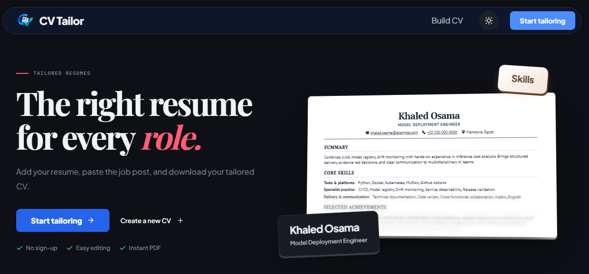
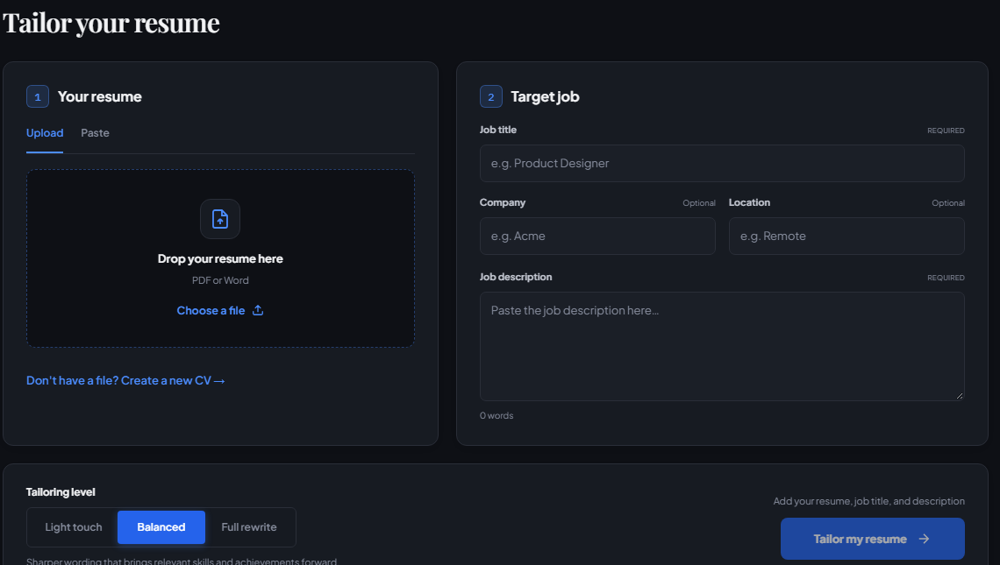
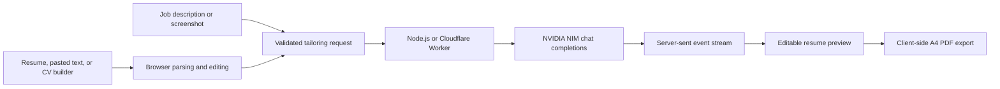

# CV Tailor

**A focused resume-tailoring workspace that turns a candidate’s experience and a target job description into an editable, ATS-conscious PDF.**

[Open the live application](https://cv-tailor.ziad-dev9.workers.dev/)

CV Tailor accepts an existing resume or a newly created CV, adapts its language to a target role, and gives the user an editable preview before export. The workflow is designed to keep the candidate in control: generated content can be reviewed and edited, and missing information is marked rather than invented.

## Screenshots

<p align="center">
  
  
</p>

<p align="center"><sub>Homepage</sub> &nbsp; · &nbsp; <sub>Resume tailoring workspace</sub></p>

## Features

- **Flexible source material:** upload PDF or DOCX, paste resume text, or build a CV from scratch. Job details can be entered directly, with support for a job-posting screenshot.
- **Streaming generation:** tailored content appears progressively in a live resume preview while the server streams the model response over Server-Sent Events.
- **Fact-aware rewriting:** prompts preserve source facts such as employers, dates, qualifications, and measurable results; unsupported details are identified with explicit placeholders.
- **Adjustable tailoring:** choose Light touch, Balanced, or Full rewrite, then select from Career, Skills, Portfolio, and Academic layouts.
- **Review before export:** edit the A4 document in the browser with undo and redo, formatting controls, and link editing.
- **Selectable-text PDF output:** generate a vector PDF in the browser, with embedded typefaces and contact-link icons.
- **Example profiles:** explore a set of sample profiles to preview the available layouts and editing experience.

## How it works



PDF and DOCX extraction and PDF generation use browser-side libraries. The application server validates requests, builds model prompts, and streams the generated result back to the browser.

## Technology

| Area | Implementation |
| --- | --- |
| Interface | HTML, CSS, and vanilla JavaScript |
| Local/API server | Node.js 18+, Express 5 |
| Edge deployment | Cloudflare Workers with Static Assets |
| Model API | NVIDIA NIM Chat Completions (`nvidia/nemotron-3.5-super-vl-120b-a12b`) |
| Streaming | Server-Sent Events (SSE) |
| Document input | PDF.js and Mammoth.js |
| PDF output | pdfmake with embedded fonts and vector icons |
| Verification | Node.js built-in test runner and syntax checks |

The project also includes a Vercel configuration for the Express server.

## Run locally

Requirements: Node.js 18 or later and an NVIDIA API key.

```bash
npm install
```

Create a local `.env` file from the example and set `NVIDIA_API_KEY`:

```env
NVIDIA_API_KEY=your-nvidia-api-key
PORT=3000
```

Start the application:

```bash
npm start
```

Open [http://localhost:3000](http://localhost:3000). Keep API credentials in environment variables; do not put real credentials in source files or commit them.

## Deploy to Cloudflare Workers

Configure the NVIDIA key as a Worker secret, then deploy with Wrangler:

```bash
npx wrangler secret put NVIDIA_API_KEY
npx wrangler deploy
```

For local Worker emulation, add `NVIDIA_API_KEY=...` to `.dev.vars` and run:

```bash
npm run cf:dev
```

The Worker configuration serves the static application from `public/` and routes `/api/*` requests through `worker.mjs`.

## Useful commands

```bash
npm start                     # Run the Express server
npm run preview                # Start a local preview server
npm run preview -- --fixture   # Fixture-based streaming preview without API calls
npm run check                  # Syntax-check server, worker, and client files
npm test                       # Run the Node.js test suite
npm run build:icons            # Rebuild generated icon assets
```

`build:icons` requires Python and the `fonttools` and `skia-pathops` packages.

## Project structure

```text
server.js                 Express entry point
worker.mjs                Cloudflare Worker entry point
lib/model.js              NVIDIA NIM request configuration
lib/prompts.js            Input validation, prompt construction, and budgets
lib/tailor-stream.js      Streaming, retries, and response recovery
public/index.html         Application markup
public/app.js             Upload flow, editor, streaming client, PDF export
public/cv-builder.js      Build-a-CV workflow
public/cv-layouts.js      Resume layout definitions and adaptation
public/live-resume.js     Live preview rendering
public/demo-profiles.js   Sample profiles for layout previews
public/vendor/            Browser-side document and PDF libraries
scripts/                  Preview server and icon generation utilities
test/                     Unit and integration tests
```

## License

Released under the [MIT License](LICENSE). Third-party browser libraries and generated icon assets retain their respective upstream license notices; see [`public/vendor/THIRD_PARTY.md`](public/vendor/THIRD_PARTY.md).
